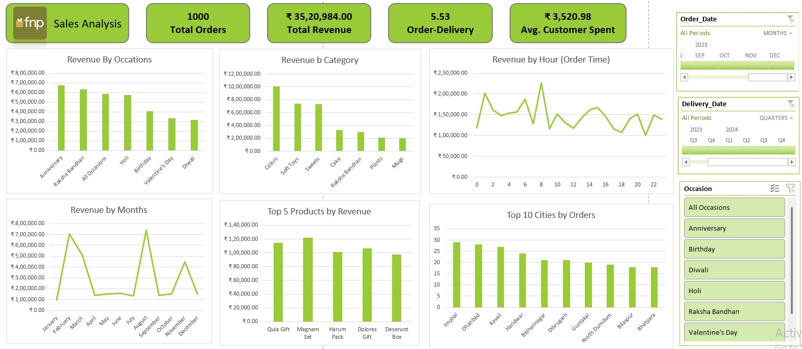

# Ferns-and-Petals-Sales-Analysis

## 1. Why did you build it?
The dashboard was built to transform a raw, complex dataset of FNP's sales (including orders, customers, and products) into an interactive, visual format. The goal was to provide an easy-to-use interface that allows stakeholders to quickly uncover key insights related to sales trends, customer behavior, and product performance without having to manually sift through spreadsheets.

## 2. What was the business problem?
Ferns N Petals is a highly seasonal, occasion-driven gifting business. The core problem was a lack of immediate visibility into how different occasions, product categories, and delivery times were impacting overall revenue and customer satisfaction. Without these insights, the company could struggle to optimize its sales strategy, manage inventory effectively for peak seasons (like Raksha Bandhan or Valentine's Day), and ensure timely deliveries.

## 3. Who is it for?
This dashboard is designed for multiple stakeholders within FNP:
*   **Sales & Marketing Teams:** To understand which occasions, months, and products drive the most revenue so they can target campaigns effectively.
*   **Operations & Supply Chain Managers:** To monitor average delivery times and track top-performing cities for logistical planning.
*   **Executive Management:** To get a high-level, real-time snapshot of the company's health (Total Revenue, Total Orders, Average Customer Spend).

## 4. What did you analyze?
The analysis focused on transactional sales data across the year 2023. The key metrics and data points analyzed include:
*   **High-Level KPIs:** Total Orders (1,000), Total Revenue (₹35.2L), Average Order-to-Delivery Time (5.53 days), and Average Customer Spend (₹3,520).
*   **Temporal Analysis:** Revenue fluctuations by Month and Order Time (Hour of day).
*   **Categorical Analysis:** Revenue broken down by Occasions (Anniversary, Raksha Bandhan, Holi, etc.) and Product Categories (Colors, Soft Toys, Sweets, Cake).
*   **Geographical Analysis:** Top 10 cities by number of orders.
*   **Product Performance:** Top 5 specific products by revenue.

## 5. What insights did you find?
Based on the dashboard visualizations, several key insights were uncovered:
*   **Occasion Dominance:** *Anniversary* and *Raksha Bandhan* are the highest revenue-generating occasions, outperforming expected heavy hitters like Diwali and Valentine's Day.
*   **Category Preferences:** *Colors* and *Soft Toys* are the most lucrative product categories, generating significantly more revenue than traditional gifts like Cakes, Plants, or Mugs.
*   **Extreme Seasonality:** Revenue experiences massive spikes in **February** (likely Valentine's Day prep) and **August** (Raksha Bandhan), with significant drop-offs in the immediate months following.
*   **Geographic Surprises:** The top ordering cities include Imphal, Dhanbad, and Kavali, indicating strong market penetration in Tier 2/3 cities.
*   **Delivery Times:** The average order-to-delivery time is 5.53 days, which is a critical metric for time-sensitive occasion gifting.

## 6. What business recommendations would you give?
*   **Pre-Season Marketing:** Since February and August see massive revenue spikes, marketing budgets and campaigns should be heavily front-loaded in January and July to capture the upcoming surge.
*   **Inventory Optimization:** Ensure supply chains are robust for "Colors" and "Soft Toys" ahead of peak seasons, as these are the undeniable cash cows. 
*   **Investigate Underperformers:** Analyze why categories like Plants and Mugs are generating the lowest revenue. Consider bundling them at a discount with high-performing Soft Toys to move inventory.
*   **Improve Delivery SLAs:** For an occasion-based gifting company, 5.53 days for delivery can be risky (e.g., a birthday gift arriving late). Operations should investigate ways to bring this average down to 2-3 days, perhaps by opening fulfillment centers closer to top cities like Imphal and Dhanbad.

## 7. What decision it helps someone make?
*   **Marketing Allocation:** Helps the marketing team decide exactly *when* to spend their ad budget and *which* occasions/categories to feature in those ads.
*   **Inventory Purchasing:** Helps the supply chain team decide which products to overstock and which to pull back on.
*   **Logistics Planning:** Helps operations decide if their current delivery network is sufficient or if they need to partner with faster courier services to reduce the 5.53-day delivery window.
